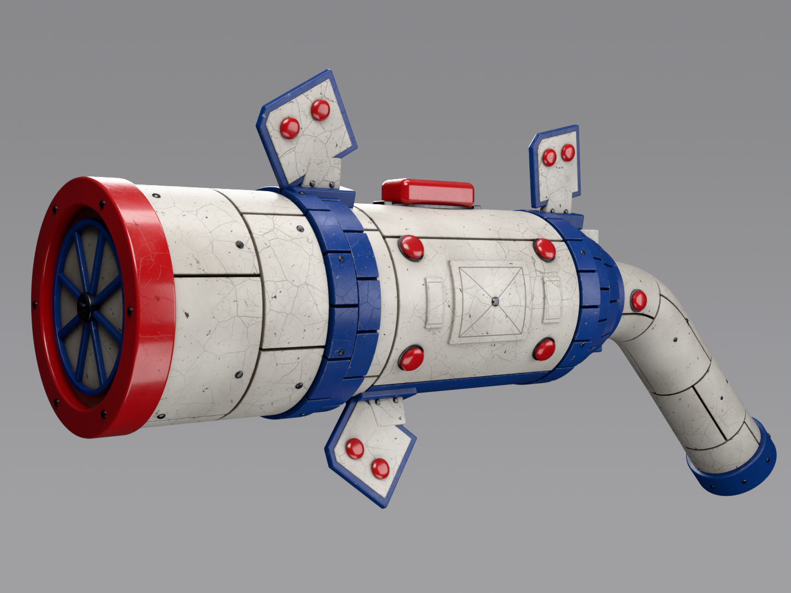
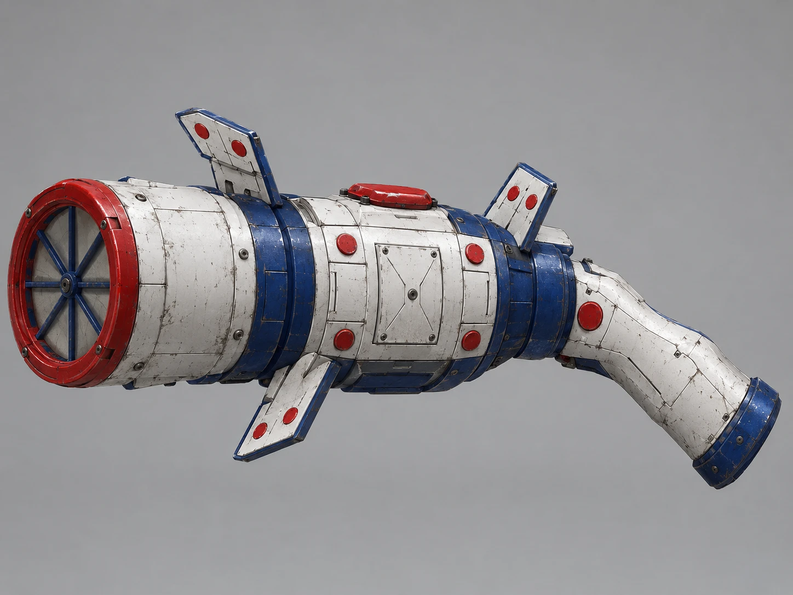

# Rocket Blaster — Blender 3D render

A procedural Blender model and Cycles render of the red / white / blue
"rocket blaster" in `reference/reference.webp`.



| Reference | Blender render |
|---|---|
|  |  |

## What's here

| Path | Contents |
|---|---|
| `blender/build_blaster.py` | Builds the whole scene from code (geometry, materials, lights, camera) and renders it |
| `blender/blaster.blend` | The generated scene, saved from Blender 5.0 (the script itself runs on 4.2+) |
| `renders/blaster.png` | Final render, 1448×1086, Cycles, 256 samples + OpenImageDenoise |
| `reference/reference.webp` | The source image |

## How it's built

- **Hull**: every white/blue section is a ring of separate curved panels with
  real seams between them, over a dark core, so the panel lines catch shadow.
  Panels are generated with `bmesh` and softened with bevel modifiers
  (hardened normals).
- **Muzzle**: red bolted rim, shallow light-grey recess, blue 8-spoke wheel
  with a steel hub.
- **Body**: engraved X-panel and slot panels (lines driven by panel UVs in the
  shader), red studs on steel washers, red top hatch on a steel base plate.
- **Fins**: three raked plates with blue edge frames, white faces, stems and
  red studs.
- **Grip tube**: panels swept along a bent path (straight → 46° arc →
  straight), ending in a bolted blue cap.
- **Worn paint** (procedural, no image textures): noise grime, ambient
  occlusion dirt in seams, Voronoi crackle in patches, edge chipping from a
  Bevel-node edge mask, small flecks, and a bump pass for cracks and chips.
- **Studio**: grey gradient backdrop seen only by camera rays, a separate soft
  environment for lighting, plus key/fill/rim/top/under area lights. The view
  transform is Khronos PBR Neutral.

## Re-render

With the Blender executable:

```bash
blender -b -P blender/build_blaster.py -- --out renders/blaster.png --blend blender/blaster.blend
```

Or with the `bpy` wheel from PyPI (Python 3.11):

```bash
pip install bpy
python3 blender/build_blaster.py --out renders/blaster.png
```

Options: `--samples N`, `--percent 50` (quick preview), `--width/--height`,
`--border X0 X1 Y0 Y1` (render only a region), `--no-render` (build only).
