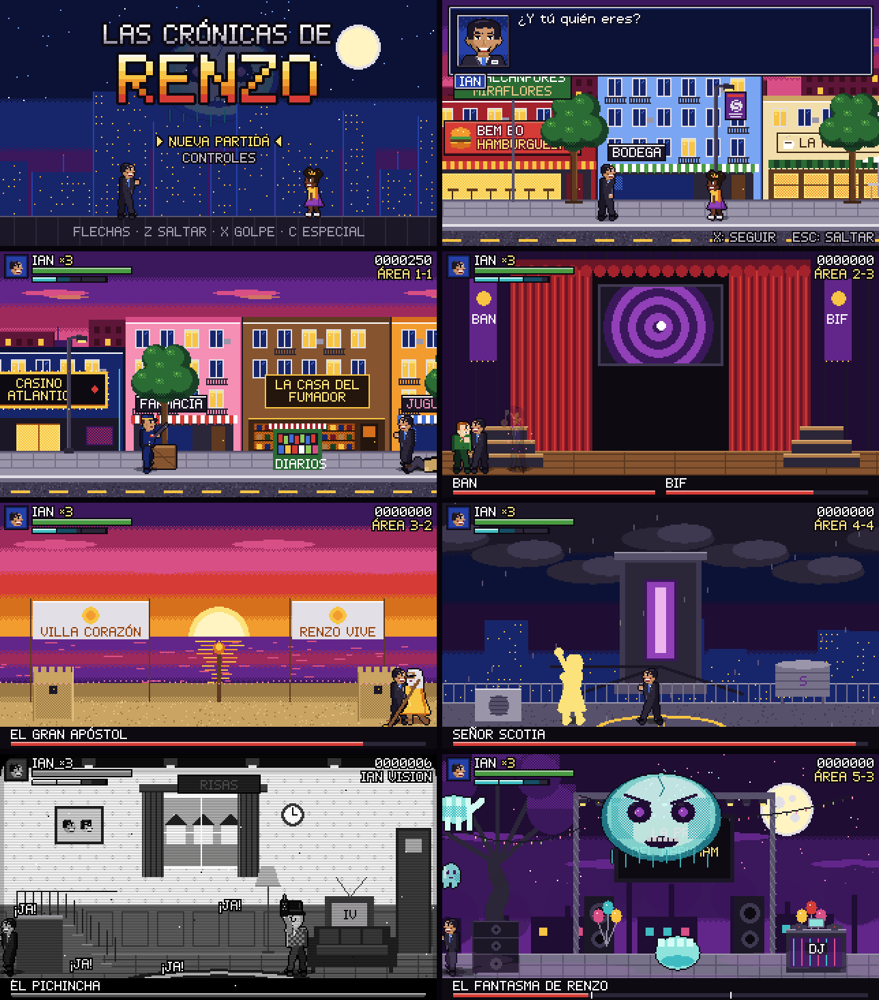

# Las Crónicas de Renzo

Beat 'em up de desplazamiento lateral con plataformas, con estética de 16 bits,
hecho en **un solo archivo HTML** (`las-cronicas-de-renzo.html`): Canvas 2D y
JavaScript, sin librerías ni archivos externos.

## Cómo jugar

Abre `las-cronicas-de-renzo.html` en cualquier navegador moderno (Chrome, Edge,
Firefox o Safari). No necesita instalación ni conexión a internet. En celulares
y tablets aparecen controles táctiles en pantalla; también funciona con mando.

| Tecla | Acción |
|---|---|
| Flechas | Moverse |
| Z | Saltar (abajo + Z: bajar de una plataforma) |
| X | Golpear (X X X = combo de tres golpes) |
| X en el aire | Patada voladora (abajo + X: patada en picada) |
| C | Ataque especial (gasta una barra de energía) |
| ↑ junto a Irma | Pedir una pista |
| Enter / Esc | Pausa (Esc en un diálogo: saltar la escena) |
| M | Silenciar |

El progreso se guarda en el navegador: desde el título puedes continuar en la
última área alcanzada. Si pierdes todas las vidas, puedes continuar desde el
inicio del tramo en el que caíste.

## Historia

Ian Stapleton ya derrotó a las fuerzas del mal de Sandro Stapleton, que resultó
ser el verdadero Renzo. Ahora el Señor Scotia instauró un gobierno de mano dura
y se está apoderando del poder de Renzo. El Puaj Supremo le revela el plan a
Ian y lo guía entre niveles.

| Parte | Escenario | Jefe |
|---|---|---|
| Área 1 | Calle Alcanfores, Miraflores (con el Bem Bo, el Casino Atlantic, La Casa del Fumador y La Rubia Café) | Comandante Garrote, líder de los ayudantes |
| Área 2 | Colegio Markham: patio, pasillo y auditorio, con los 010 hipnotizados | Ban y Bif, pelea doble |
| Área 3 | Asia: la playa de los Apóstoles de Renzo y el sagrado ataque a la Villa Corazón | El Gran Apóstol |
| Área 4 | Torre Scotia: recepción, piso 13, piso 27 y la azotea | Señor Scotia (dos fases) |
| Especial | **Ian Vision**: sitcom de los años 50 en blanco y negro, con risas grabadas y aplausos | El Pichincha, primo maligno de Scotia |
| Área 5 | La pre del Markham: la fiesta (terraza, pista de baile y escenario del DJ) | El Fantasma de Renzo (tres fases) |

Cada parte tiene diálogos con retratos antes y después, varias oleadas de
enemigos y un jefe con patrones de ataque propios. El juego termina con una
escena de victoria y créditos.

**Irma**, una señora de la sierra peruana con su bombín, sus trenzas, su manta y
su pollera, está al inicio de cada nivel. Si te acercas y pulsas ↑, te dice
exactamente todo lo que está pasando.

## Objetos

| Objeto | Efecto |
|---|---|
| Anticucho | +25 de vida |
| Picarones | +45 de vida |
| Ceviche | Vida completa |
| Chicha morada | Recupera energía |
| Cabeza de Ian | Vida extra |
| Sol de oro | Puntos |

Se obtienen rompiendo tachos, cajas, coolers, buzones, regalos y piñatas, y a
veces al derrotar enemigos.

## Detalles técnicos

- Resolución interna de 320×180 escalada sin suavizado, con una paleta limitada
  de 69 colores.
- Todos los sprites, retratos y fondos se dibujan por código al iniciar: no hay
  imágenes incrustadas. El aspecto de Ian (traje negro, camisa blanca, corbata
  azul y credencial) se basa en la foto de referencia.
- Música chiptune generada con la Web Audio API: 16 canciones (una por área y
  por jefe, con una extra para la última fase del Fantasma, más el título, la
  historia y el final), jingles de área superada y Game Over, y efectos de
  sonido sintetizados, incluidos las risas grabadas y los aplausos de Ian Vision.
- Un único archivo de unos 340 KB.
